# Lab8Web - Praktikum 8: PHP dan Database MySQL

**Nama:** (CHOIRUL MAJID) | **NIM:** (312510174) | **Kelas:** (I253C)

## Tujuan

Membuat program CRUD (Create, Read, Update, Delete) sederhana menggunakan PHP dan MySQL dengan studi kasus data barang.

## 1. Persiapan

Jalankan **Apache** dan **MySQL** lewat XAMPP Control Panel, lalu buka `http://localhost/phpmyadmin/`.


## 2. Database dan Tabel

Dibuat database `latihan1` dan tabel `data_barang` (kolom: `id_barang`, `kategori`, `nama`, `gambar`, `harga_beli`, `harga_jual`, `stok`), lalu diisi tiga data contoh dengan `INSERT INTO`.

```sql
CREATE DATABASE latihan1;
```
 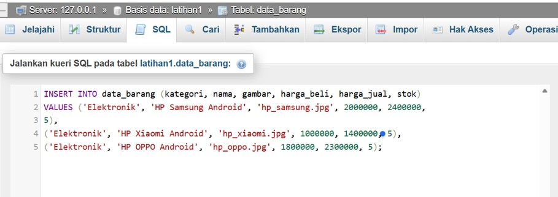

 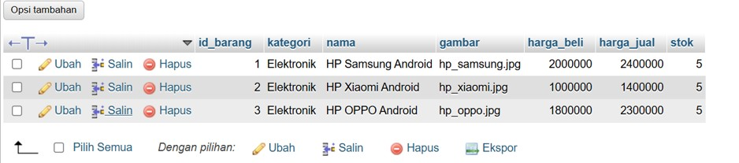

## 3. Program CRUD

Semua file disimpan di `htdocs/lab8_php_database` beserta folder `gambar` untuk menyimpan hasil upload.

| File | Fungsi |
|---|---|
| `koneksi.php` | Koneksi ke database dengan `mysqli_connect()` |
| `index.php` | **Read**: menampilkan data dalam tabel, dengan tautan Tambah, Ubah, dan Hapus |
| `tambah.php` | **Create**: form tambah barang beserta upload gambar, data disimpan dengan `INSERT` |
| `ubah.php` | **Update**: form terisi data lama berdasarkan `id`, data diperbarui dengan `UPDATE` |
| `hapus.php` | **Delete**: menghapus data berdasarkan `id` dengan `DELETE` |

**Koneksi database**

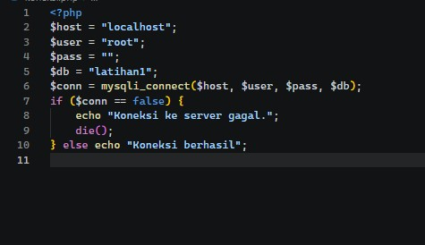

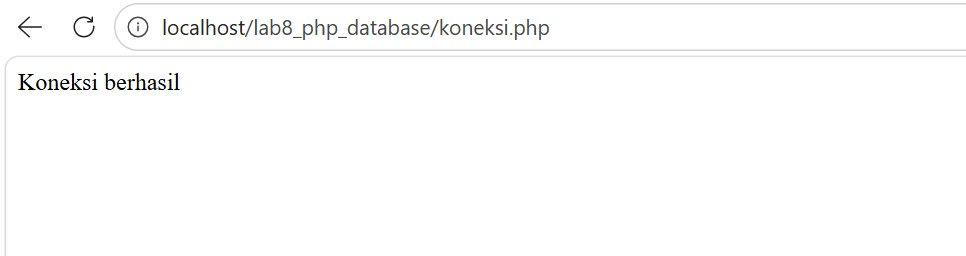


**Tampil data (Read)**
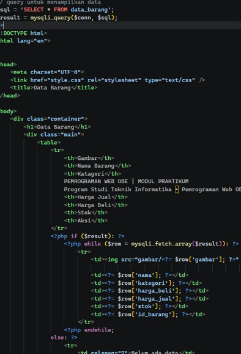

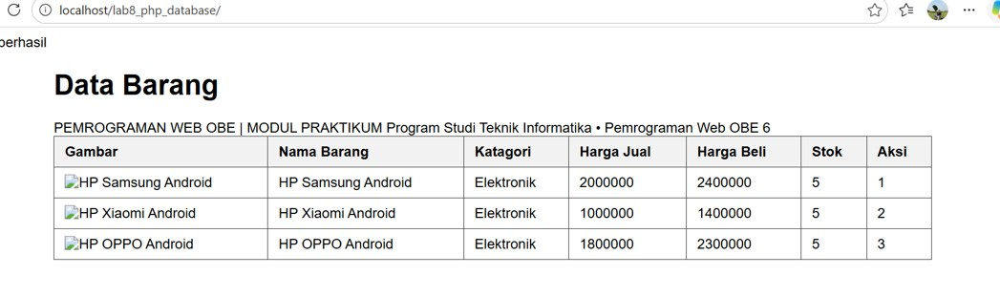


**Tambah data (Create)**

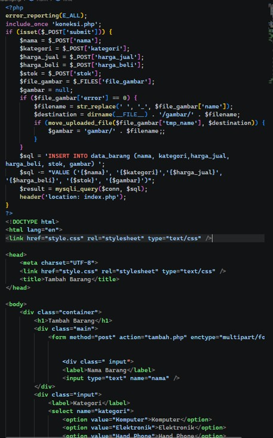

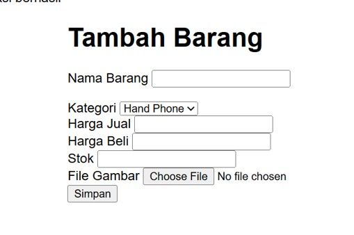


**Ubah data (Update)**

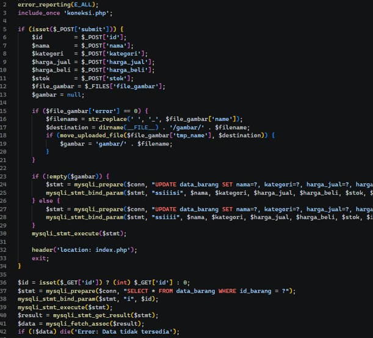

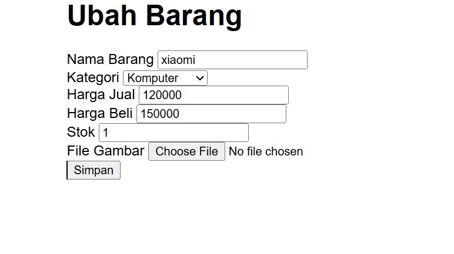


**Hapus data (Delete)**

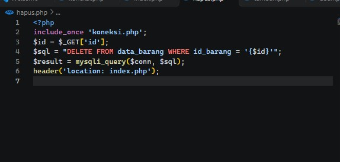

**sebelum di hapus data**

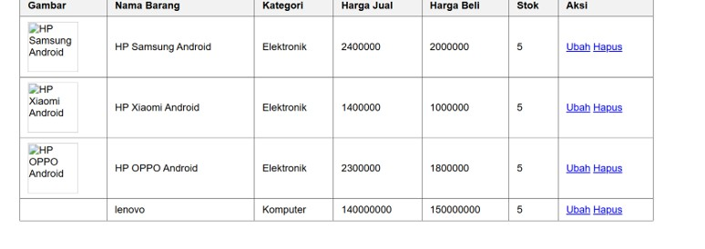

**setelah dihapus**

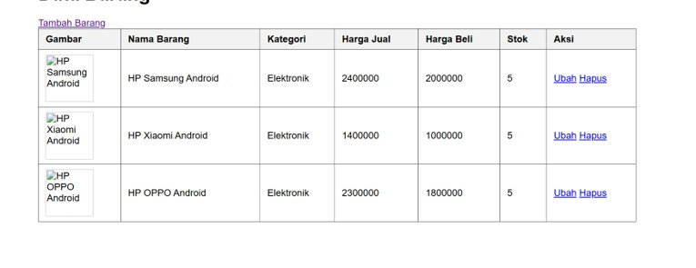


## 4. Perbaikan dari Kode Modul

- `ubah.php`: `enctype` diperbaiki menjadi `multipart/form-data`, dan dropdown kategori dibandingkan dengan nilainya masing-masing agar terpilih dengan benar. Query memakai prepared statement.
- `index.php`: kolom Aksi diganti tautan Ubah dan Hapus, isi kolom harga disesuaikan dengan header, dan path gambar diperbaiki agar tidak ganda.

## 5. Kesimpulan

Dengan PHP dan MySQL, operasi CRUD dapat dibuat memakai perintah SQL `INSERT`, `SELECT`, `UPDATE`, dan `DELETE` yang dijalankan lewat `mysqli_query()`. Input pengguna sebaiknya diproses dengan prepared statement untuk menghindari SQL injection.
